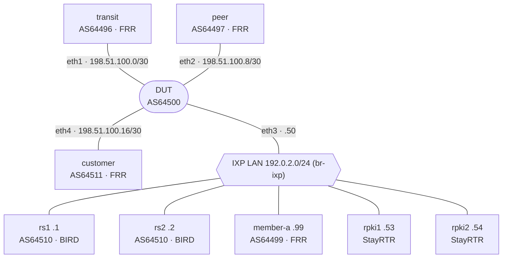

# Interconnection Guidelines — containerlab labs

Hands-on labs for the course **Interconnection Guidelines and Operational Best Practices**.
Every lab puts one router under test (the **DUT**, AS64500) in the same neighbourhood: a transit provider, a private peer, an IXP with two route servers, a customer and two RPKI validators. The neighbours announce legitimate routes **and trap routes** (bogons, RPKI Invalids, leaks, more-specifics of your own space…). A vendor-neutral script then checks what the DUT accepted and what it announced.

The same 28 checks are designed to run against ten platforms, so learners can compare how each vendor implements the same MANRS-aligned policy.

| Lab | DUT | Image | Status |
| --- | --- | --- | --- |
| `frr` | FRRouting 10.x | `quay.io/frrouting/frr` (public) | Validated: 28/28 (containerlab 0.74.3, FRR 10.2.1) |
| `bird` | BIRD 2.17 | built locally from `common/images/bird` | Validated: 28/28 (containerlab 0.74.3, BIRD 2.17.5) |
| `gobgp` | GoBGP 4.x | built locally from `common/images/gobgp` | Validated: 28/28 (containerlab 0.74.3, GoBGP 4.10.0) |
| `srlinux` | Nokia SR Linux | `ghcr.io/nokia/srlinux` (public) | Validated: 27/28 + 1 GAP, no ROV (containerlab 0.74.3, SR Linux 26.7.2) |
| `eos` | Arista cEOS | `ceos` - free download from arista.com | Available - testing on containerlab |
| `routeros` | MikroTik RouterOS v7.20+ | CHR built with [vrnetlab](https://github.com/srl-labs/vrnetlab) | Planned |
| `junos` | Juniper Junos | vJunos-router built with vrnetlab | Planned |
| `iosxe` | Cisco IOS XE | Catalyst 8000v built with vrnetlab | Planned |
| `iosxr` | Cisco IOS XR | XRd control-plane (Cisco download) | Planned |
| `sros` | Nokia SR OS (MD-CLI) | vSIM built with vrnetlab + licence | Planned |

Labs are added one at a time: each one is deployed on containerlab and must pass the checks before it is published here.

## Topology



The validators sit on the IXP LAN only to keep the lab small; in production they belong in your own infrastructure.

## Quick start

Requirements: Linux host, Docker, [containerlab](https://containerlab.dev/install/) 0.6x+, Python 3, `sudo`.

On **macOS**, run everything inside a Linux VM. [OrbStack](https://orbstack.dev) works well: it shares `/Users` with the VM, so you edit on the Mac and run the lab in the VM:

```bash
orb create ubuntu clab && orb -m clab
curl -sL https://containerlab.dev/setup | sudo -E bash -s "all"   # Docker + containerlab
sudo usermod -aG docker $USER && exit                            # then: orb -m clab
```

On Apple Silicon only the container-native labs run (FRR, BIRD, GoBGP, SR Linux, cEOS); the VM-based images (RouterOS, IOS XE, IOS XR, Junos, SR OS) need an x86_64 Linux host.

```bash
git clone https://github.com/vitokosk8/interconnection-labs.git
cd interconnection-labs
scripts/deploy.sh frr        # builds the BIRD and RTR images the first time
scripts/check.sh frr         # 28 checks, PASS / FAIL / GAP
scripts/destroy.sh frr       # add --all to also remove the br-ixp bridge
```

Run **one lab at a time**: every lab uses the same host bridge `br-ixp`.

Give the lab **about 90 seconds** before running the checks. The BGP sessions come up in a few seconds, but the RPKI validators can take longer: BIRD 2.17 first offers RTR version 2 (with ASPA), StayRTR rejects it, and BIRD reconnects with an older version on its next retry. Until a validator is connected, the DUT cannot know that 45.12.0.0/16 is Invalid and `IMP-RPKI-INVALID` fails. That is ROV failing open (Lesson 5.2), not a filter bug.

Image overrides use environment variables, for example:

```bash
FRR_IMAGE=quay.io/frrouting/frr:10.3.1 scripts/deploy.sh frr
```

| Variable | Default |
| --- | --- |
| `FRR_IMAGE` | `quay.io/frrouting/frr:10.2.1` |
| `BIRD_IMAGE` / `RPKI_IMAGE` | `ig/bird:latest` / `ig/rpki:latest` (built by `deploy.sh`) |
| `CEOS_IMAGE` | `ceos:latest` - import it yourself, see below |
| `GOBGP_IMAGE` | `ig/gobgp:latest` (built by `deploy.sh gobgp`, GoBGP 4.10.0) |

### Arista cEOS image

cEOS is free but needs an arista.com account: Software Downloads, EOS, cEOS-lab. On Apple Silicon take the `cEOSarm-lab-<version>.tar.xz` build, on x86_64 `cEOS64-lab-<version>.tar.xz`. Import it inside the Linux VM:

```bash
docker import cEOS*-lab-*.tar.xz ceos:latest      # or any tag, then CEOS_IMAGE=ceos:<tag>
scripts/deploy.sh eos
```

cEOS takes 1-2 minutes to boot before BGP starts.

Check the build after the first deploy: `docker exec clab-ig-eos-dut Cli -c "show version" | grep Architecture` must say `aarch64` on Apple Silicon. An x86 image (`i686` / `x86_64`) still starts under emulation, but its forwarding agent crashes and all Ethernet ports stay down ("BGP inactive"). `docker image inspect` does not help here: `docker import` labels the image with the host architecture whatever it contains. `scripts/check.sh eos` warns about this.

## What is tested

The DUT is never queried directly. The **customer** receives the DUT's full table, so it shows everything the DUT accepted. **Transit, peer and member-a** show what the DUT announced.

| Check | Seen at | Prefix | Expected | Lesson |
| --- | --- | --- | --- | --- |
| IMP-VALID | customer | 45.10.0.0/16 (RPKI Valid) | present | 5.2 |
| IMP-NOTFOUND | customer | 45.11.0.0/16 (NotFound) | present | 5.2 |
| IMP-PEER | customer | 45.20.0.0/16 | present | 4.2 |
| IMP-IXP | customer | 45.30.0.0/16 (via route servers) | present | 6.1 |
| IMP-RPKI-INVALID | customer | 45.12.0.0/16 (Invalid) | absent | 5.2 |
| IMP-BOGON | customer | 10.0.0.0/8 | absent | 3.2 |
| IMP-TOO-LONG | customer | 45.13.1.0/25 | absent | 3.2 |
| IMP-OWN-SPACE | customer | 203.0.113.0/25 | absent | 3.4 |
| IMP-IXP-LAN | customer | 192.0.2.0/24 | absent | 3.4 |
| IMP-BOGON-ASN | customer | 45.14.0.0/16 (AS64512 in path) | absent | 3.3 |
| IMP-LONG-PATH | customer | 45.15.0.0/16 (52 ASNs) | absent | 3.3 |
| IMP-DEFAULT | customer | 0.0.0.0/0 | absent | 3.4 |
| IMP-PEER-LEAK | customer | 45.21.0.0/16 (AS3356 behind the peer) | absent | 3.6 |
| IMP-IXP-LEAK | customer | 45.31.0.0/16 (AS174 behind member-a) | absent | 3.6 |
| CUST-IRR | transit | 198.51.100.0/24 (in the customer's IRR set) | present | 3.5 |
| CUST-NOT-IRR | transit | 45.40.0.0/16 (not in the IRR set) | absent | 3.5 |
| EXP-OWN-* | transit, peer, member-a | 203.0.113.0/24 | present | 4.3 |
| EXP-CUST-IXP | member-a | 198.51.100.0/24 | present | 4.4 |
| EXP-DNA-PEER | peer | 198.51.100.0/24 ("do not announce to AS64497") | absent | 4.6 |
| LEAK-* (5 checks) | transit, peer, member-a | transit, peer and IXP routes | absent | 4.4 |
| COMM-OWN / COMM-CUST | transit | own and customer tags | 64500:1:1 / 64500:1:3 | 4.2 |

The peer's route 45.20.0.0/16 carries a **fake customer tag** (64500:1:3). It must still not reach transit, which proves the DUT scrubs its own communities on ingress (Lesson 3.7).

`GAP` marks a check that fails because of a platform limitation listed in `labs/<vendor>/known-gaps.txt` (for example, SR Linux has no RPKI ROV). Gaps do not count as failures.

## MANRS mapping

| MANRS action | Where the lab exercises it |
| --- | --- |
| NO-1 Filtering | IMP-*, CUST-*, EXP-*, LEAK-* |
| NO-2 Anti-spoofing | uRPF / ACL on the customer port (in the configs; not checked automatically) |
| NO-3 Coordination | Not testable in a lab: PeeringDB and RIR contacts |
| NO-4 Global validation | RPKI VRPs in `common/neighbors/rpki/vrps.json`, used by IMP-VALID / IMP-RPKI-INVALID |

## Suggested exercises

1. **Break it on purpose.** Remove the sanity call from the transit import policy, reload and re-run the checks. Watch which IMP-* checks turn red.
2. **RPKI re-evaluation (Lesson 5.2).** Deploy with the validators stopped (`docker stop clab-ig-<vendor>-rpki1 clab-ig-<vendor>-rpki2`), let BGP converge, start them again, then run the checks. Does IMP-RPKI-INVALID pass without a manual refresh? FRR 8.x needed `clear bgp * soft in`; BIRD re-evaluates automatically thanks to `import table on`; GoBGP does not re-evaluate at all and needs `gobgp neighbor all softresetin` (its `startup.sh` does this once the validators are in sync - try it without).
3. **Roles as a safety net (Lesson 4.5).** On FRR or BIRD, open the export filter towards the peer (`accept` everything) and re-run the checks. The transit routes still do not reach the peer: RFC 9234 roles and the OTC attribute stop them.
4. **Graceful shutdown (Lesson 7.1).** Drain the DUT with the maintenance command shown at the end of its configuration and look at the local preference of the DUT's routes on transit.
5. **Generate the customer filter.** Replace the placeholder customer list with real `bgpq4` output for an as-set of your choice and adapt `customer/frr.conf`.

## Repository layout

```
common/
  neighbors/     transit, peer, customer, member-a (FRR); rs1, rs2 (BIRD); rpki VRPs
  images/        Dockerfiles for the BIRD, StayRTR and GoBGP images
  tests/check.py vendor-neutral checks (Python 3 standard library only)
labs/<vendor>/
  <vendor>.clab.yml   topology (identical neighbours, vendor-specific DUT)
  dut/                DUT configuration, lab edition
  known-gaps.txt      checks expected to fail for platform reasons (optional)
scripts/          deploy.sh, check.sh, destroy.sh
```

## Notes and pitfalls

- **Lab-only address space.** The 45.x.0.0/16 prefixes are real address space used only inside an isolated lab. Never connect the lab to the Internet.
- **Documentation filters are disabled.** The lab is built on documentation prefixes and ASNs, so every DUT config ships with those filters commented out and marked `PRODUCTION`. Enable them on real networks.
- **No session authentication in the lab.** TCP-MD5 needs kernel support (`CONFIG_TCP_MD5SIG`), and the kernels of OrbStack and Docker Desktop do not have it. BIRD 2.17 refuses to start a session in that case ("Kernel does not support TCP MD5 signatures"); FRR silently runs the session *without* MD5. Rather than depend on the host kernel, the lab sessions run unauthenticated and every config shows the production line as a comment. The reference configurations keep TCP-MD5 / TCP-AO (Lesson 2.2). To check your host: `zcat /proc/config.gz 2>/dev/null | grep TCP_MD5 || grep TCP_MD5 /boot/config-$(uname -r)`.
- **GTSM.** The FRR neighbours send TTL 255 (`ebgp-multihop 255`) and accept any TTL, so they work with DUTs with and without GTSM. The BIRD route servers enforce GTSM; SR Linux, which has no GTSM, reaches them with `multihop maximum-hops 255`.
- **SR Linux startup files.** Containerlab loads `config.cli` in one commit. The SR Linux CLI reads an apostrophe as the start of a quoted string, even inside a `#` comment. One unpaired apostrophe silently discards every line after it, with no error. Keep comments free of `'`.
- **Editing bind-mounted files.** Editors that replace the file (`sed -i`, some `vim` settings) break Docker bind mounts: the container keeps the old file. Edit in place or redeploy.
- **IXP LAN forwarding.** If the route-server sessions stay in `Connect`, Docker's `FORWARD DROP` policy is blocking the bridge; `deploy.sh` adds the `DOCKER-USER` rule that fixes it.

## License

MIT - see [LICENSE](LICENSE).
